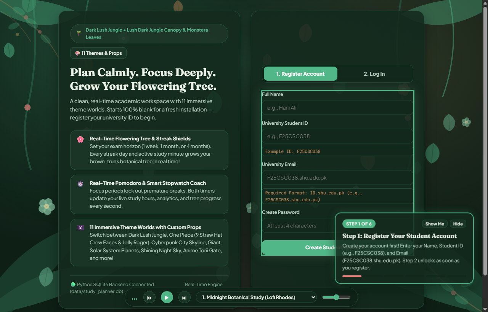
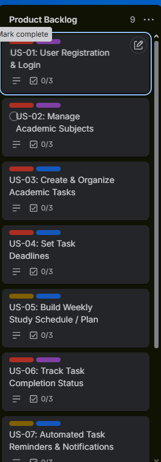
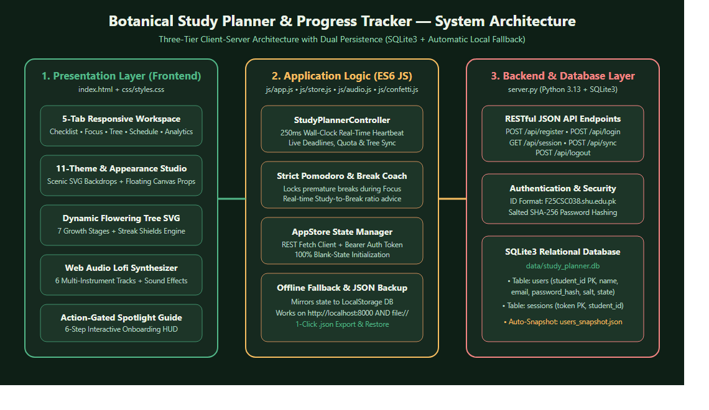
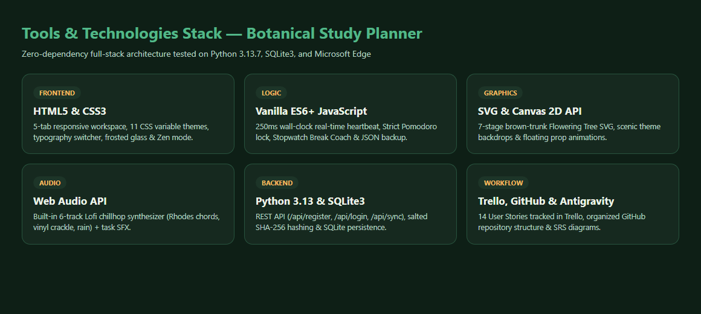

# Tools, Frameworks, Platforms & Technologies Documentation
## Botanical Study Planner and Progress Tracker

This document lists every tool, language, library, platform, and API used to design, build, manage, test, and document the **Botanical Study Planner and Progress Tracker**, along with descriptions of how each was used and visual screenshots.

---

## 1. Core Application Technologies (100% Free & Open-Source)

| Technology / Tool | Category | How It Was Used in This Project |
| :--- | :--- | :--- |
| **HTML5** | Markup & Structure | Built the semantic single-page application shell (`index.html`) including the dedicated Registration/Login screen, 5-tab workspace, Appearance Studio modal, Lofi music dock, and inline SVG botanical elements. |
| **CSS3 (Custom Properties & Grid/Flexbox)** | Styling & Theming | Powered all **11 Theme Worlds** (`[data-theme="..."]` CSS variables), typography presets (`sans`, `serif`, `rounded`, `mono`), dynamic card corner radii, frosted glass (`backdrop-filter: blur(16px)`), Zen Focus Mode, and spotlight pulse animations (`css/styles.css`). |
| **Vanilla JavaScript (ES6+)** | Application Logic | Implemented the `StudyPlannerController` (`js/app.js`), `AppStore` (`js/store.js`), 250ms wall-clock real-time heartbeat, Strict Pomodoro lock, Smart Stopwatch Break Coach, real-time deadline scanner, and `.json` backup export/import. |
| **HTML5 Canvas 2D API & SVG** | Graphics & Animation | Rendered the dynamic 7-stage brown-trunk Flowering Tree SVG (`buildTreeSvg`), full-screen scenic theme backdrops (`#theme-backdrop`), celebratory leaf confetti, and floating theme props (e.g., 9 Straw Hat Crew faces, Cyberpunk drones, Ringed Planets) in `js/confetti.js`. |
| **Web Audio API** | Audio Synthesis | Synthesized 6 multi-instrument Lofi chillhop tracks (Rhodes chords, bassline, vinyl crackle, rain noise) plus task completion and timer bell sound effects completely offline (`js/audio.js`). |
| **Python 3.13 (`http.server`, `sqlite3`, `hashlib`)** | Backend Server & Auth | Provided a zero-dependency RESTful web server (`server.py`) handling static asset serving with `no-store` cache headers, `/api/register`, `/api/login`, `/api/session`, `/api/sync`, `/api/logout`, and salted SHA-256 password hashing. |
| **SQLite3** | Relational Database | Stored registered student accounts, salted password hashes, active Bearer session tokens, and full JSON planner states locally in `data/study_planner.db` (excluded from Git via `.gitignore` so the repository stays in a blank state). |
| **Google Fonts** | Typography | Loaded `Plus Jakarta Sans`, `Fraunces`, `Quicksand`, and `JetBrains Mono` for the Appearance Studio typography switcher. |

---

## 2. Development, Project Management & Testing Tools

| Tool / Platform | Category | How It Was Used in This Project |
| :--- | :--- | :--- |
| **Trello (Atlassian)** | Agile Project Management | Managed the Product Backlog, Sprint Backlog, and Done lists for all 14 User Stories (`US-01`–`US-14`) and 26 acceptance-criteria checklist items at `https://trello.com/b/7rFTsg0p/study-planner-and-progress-tracker`. |
| **GitHub** | Version Control & Hosting | Hosts the organized source code, SRS documentation, architecture diagrams, tools screenshots, and `Paid_Tools_Links.txt` for instructor evaluation. |
| **Google Antigravity IDE** | AI-Assisted Development | Used for full-stack code editing, SVG vector generation, automated Trello board synchronization, and end-to-end API testing. |
| **Microsoft Edge (Headless & Desktop)** | Browser Testing & Capture | Used to verify live UI rendering, test real-time timers and 11-theme switching, and capture verification screenshots. |

---

## 3. Tool & Application Screenshots

### 3.1 Live Application — Blank-State Registration & Theme Studio (`HTML5 / CSS3 / ES6 / Python SQLite`)

*Figure 1: Live application served by `server.py` on `http://localhost:8000` in the default Dark Lush Jungle theme, showing the `ID.shu.edu.pk` registration form, Action-Gated Guide HUD, and Lofi Music Dock.*

### 3.2 Trello Agile Board (`US-01` – `US-14` Backlog & Tracking)

*Figure 2: Trello board used to track all User Stories (`US-01` through `US-14`), labels, and acceptance-criteria checklists.*

### 3.3 System Architecture & Technology Stack Visual (`Python + SQLite3 + ES6 + Canvas/SVG`)

*Figure 3: Three-tier architecture diagram illustrating the Frontend Presentation Layer, ES6 Application Logic Layer, and Python 3 + SQLite3 Backend Layer.*

### 3.4 Tools & Technologies Stack Overview

*Figure 4: Visual summary of all runtime, database, project management, and version control technologies used in the project.*
